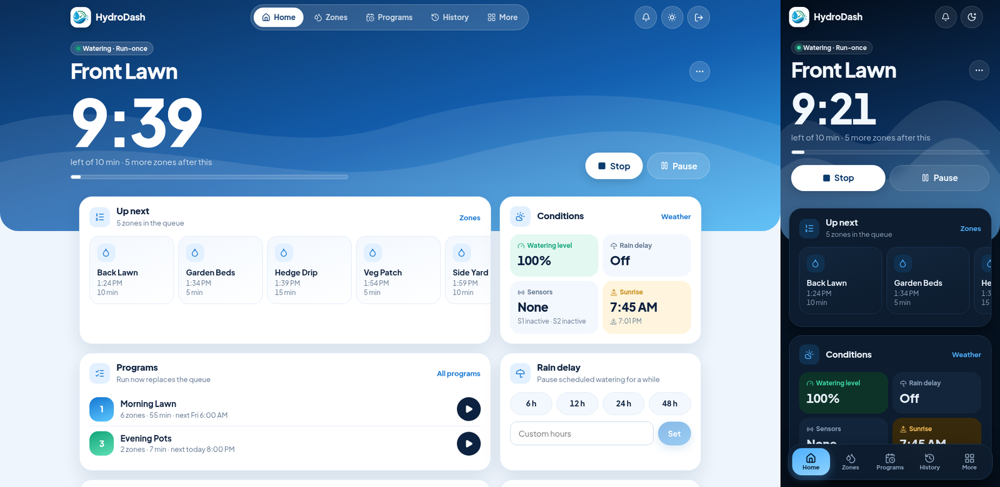
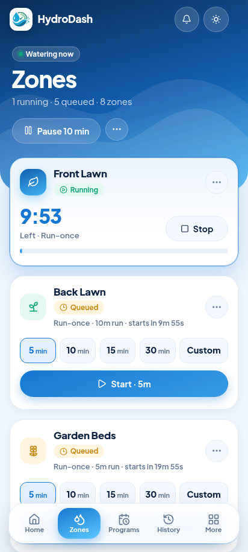
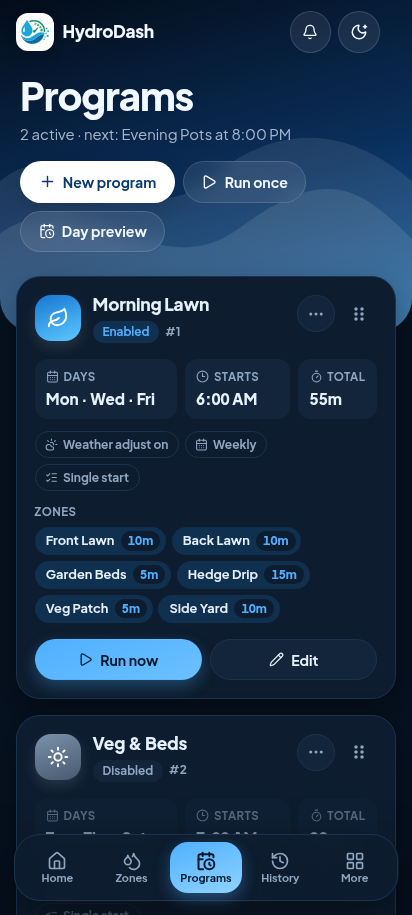
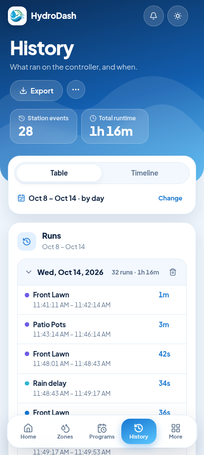
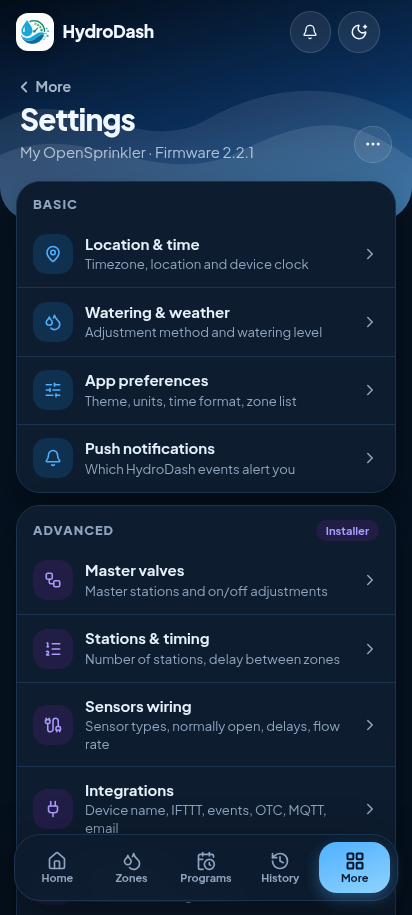
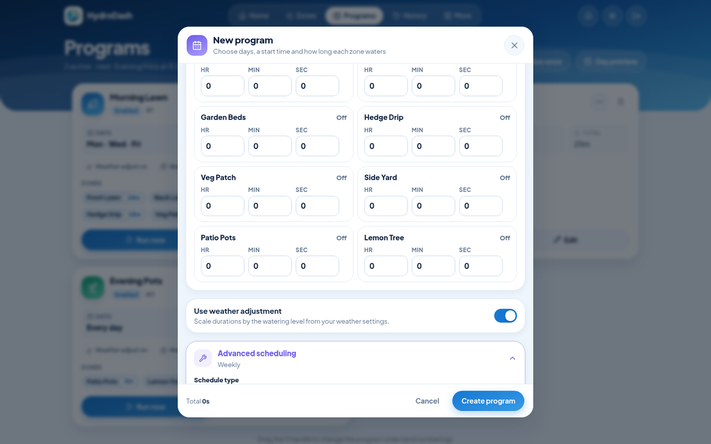
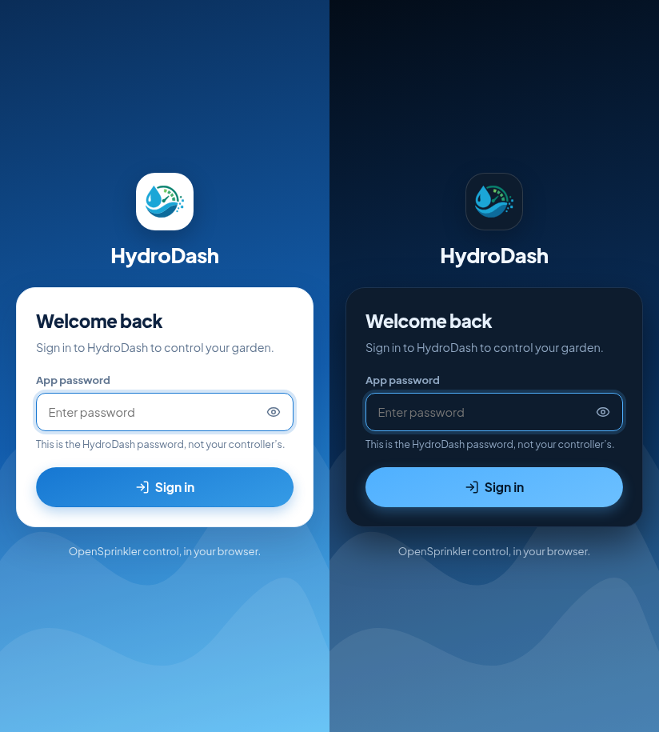

<h1 style="display:flex;align-items:center;gap:0.5rem">
  
  HydroDash
</h1>

A modern, mobile-first web app for **OpenSprinkler** irrigation controllers: water a zone in two taps, see what's running from your lock screen notifications, and keep the installer-level settings out of the way until you need them.

The npm package name in `package.json` is **hydrodash**; a default `git clone` of this repo creates a **HydroDash** directory.

**Stack:** [TanStack Start](https://tanstack.com/start) (Vite + SSR), React 19, React Query, file-based routing. OpenSprinkler API access goes through server routes under `/api/os/*` (your controller password never reaches the browser); browser login uses cookie sessions (`/api/auth/*`). Push notifications are sent by a small worker to [ntfy](https://ntfy.sh).



---

## Features

- **Home**: a live *Now running* header (zone, countdown, progress, stop / pause; several zones at once), what's up next, conditions (watering level, rain delay, sensors, sunrise/sunset, weather readings when your provider sends them), one-tap rain delay, quick program runs, recent activity and controller status. Cards can be hidden and reordered (*Customize Home*).
- **Zones**: start any zone with 5/10/15/30-minute chips or a custom duration, live countdown on the running zone, rename and enable/disable, station attributes.
- **Programs**: clear program cards, run now / run once, a program editor with everyday fields up front and advanced scheduling (interval, odd/even, repeats, sunrise/sunset starts, date ranges) tucked away, and a day *Schedule preview*.
- **History**: table or timeline of what ran, grouped by day or zone, with export.
- **Weather**: watering level, adjustment method and status, live readings, provider and API key.
- **Sensors**: extended analog sensors (live values, charts, editor) on firmware that supports them.
- **Settings**: split into **Basic** (location & time, watering, app preferences) and **Advanced** (master valves, stations, sensor wiring, integrations: MQTT / email / IFTTT / OTC, LCD, network, power, logging, security incl. password change, and a *Danger zone*).
- **Notifications**: in-app inbox plus ntfy push for zone/program starts and stops, rain delay, sensors, weather errors and *controller unreachable / back online* alerts.
- **More**: backup & restore (controller and app settings), multiple controllers, diagnostics.
- **Light and dark** themes (or follow the system), installable-feeling phone layout with a bottom tab bar, keyboard- and screen-reader-friendly controls.

### Basic vs advanced

Everyday controls live on the five tabs and at the top of each page. Installer and power-user options sit in **purple, dashed "Advanced" sections** (collapsed by default: turn on *Settings → App preferences → Show advanced options* to expand them everywhere). Anything destructive is **red, always confirmed**, and kept in a `⋯` menu or *Settings → Danger zone*. The full map is in [docs/redesign/information-architecture.md](docs/redesign/information-architecture.md).

---

## Screenshots

| Zones | Programs | History | Settings |
| --- | --- | --- | --- |
|  |  |  |  |

| Program editor | Login |
| --- | --- |
|  |  |

---

## Contributing

- **Home cards**: to add a card to Home, follow **[Contributing Home cards](docs/contributing-widgets.md)**.
- **Design**: the design system (tokens, shared components, basic/advanced/destructive rules) and the page map are in **[docs/redesign/](docs/redesign/)**; [feature-inventory.md](docs/redesign/feature-inventory.md) lists every feature and where it lives.
- **Roadmap**: **[Roadmap requirements](docs/roadmap-requirements.md)** collects planning notes for larger features (goals, gaps, API/UX notes, draft acceptance criteria).

Before opening a PR run `npm run lint` and `npx tsc --noEmit -p tsconfig.app.json`, and check your change on a phone-sized and a desktop window in light and dark mode.

---

## Requirements

- **Node.js** 20+ (TanStack Start / Vite 8 recommend **22.12+**)
- **npm** 10+

---

## Local development

1. Copy environment template and edit values:

   ```bash
   cp .env.example .env
   ```

2. Install dependencies and start the dev server:

   ```bash
   npm install
   npm run dev
   ```

   Default dev URL: `http://127.0.0.1:5173`

3. **No controller handy?** The official firmware builds a simulated controller for Docker:

   ```bash
   git clone --depth 1 https://github.com/OpenSprinkler/OpenSprinkler-Firmware.git
   cd OpenSprinkler-Firmware && git submodule update --init --depth 1
   docker build --build-arg BUILD_VERSION=DEMO -t opensprinkler-demo .
   docker run -d -p 18080:80 opensprinkler-demo
   ```

   Then set `OS_BASE_URL=http://127.0.0.1:18080` and `OS_PASSWORD=opendoor` (the firmware default) in `.env`.

---

## Environment variables

Every variable is documented in **[docs/environment.md](docs/environment.md)**. **`docker-compose.yml`** only references **`${VAR}`** names (no defaults in YAML); put values in a **`.env`** next to it (see [`.env.example`](.env.example)). Same `.env` works for **`npm run dev`**.

---

## Production build (Node)

TanStack Start builds **client** assets under `dist/client` and the **SSR server** under `dist/server`. Production serving in this repo uses Vite’s preview server (SSR-capable), not a static file server alone.

```bash
npm install
npm run build
npm run start
```

- `npm run start` runs `vite preview --host 0.0.0.0 --port 4173`.
- Open `http://127.0.0.1:4173` (set the same env vars as development, especially `OS_*` and `HYDRODASH_*`).

For a quick static check without SSR, `npm run preview` uses the same mechanism with default host/port.

---

## Docker

### Single container (Node only)

From this directory:

```bash
docker build -t hydrodash --build-arg VITE_OPENSPLINKER_BASE_URL=/api/os .
docker run --rm -p 4173:4173 --env-file .env hydrodash
```

Then open `http://127.0.0.1:4173`. Ensure `.env` exists (copy from `.env.example`). The build arg matches what CI passes; use another path only if you change the API prefix.

The image runs `npm run start` inside the container. `Dockerfile` uses `npm install` in the build stage for compatibility when the lockfile and `npm ci` disagree; for reproducible CI images, keep `package-lock.json` in sync (`npm install` locally, commit) and switch the build stage to `npm ci` if you prefer.

### Docker Compose: HydroDash + MariaDB + notifications

[`docker-compose.yml`](docker-compose.yml) pulls the **pre-built app image** from **GitHub Container Registry** (CI builds from **[github.com/gilbertorconde/HydroDash](https://github.com/gilbertorconde/HydroDash)**). Environment entries use **`${VAR}`** only; define variables in **`.env`** (or the shell) before `docker compose up`. See [docs/environment.md](docs/environment.md) and [`.env.example`](.env.example).

```bash
docker compose up
```

**`hydrodash`** and **`hydrodash-notify`** share the same image (`command: node dist/notifications-service.mjs` on notify). The notify worker polls the controller (default every 45 s), pushes to ntfy, alerts when the controller has been unreachable for `NOTIFICATIONS_OFFLINE_ALERT_MIN` minutes, and exposes `GET /health` (503 when its poll loop stalls) used by the Compose `healthcheck`. If you run the stack from Portainer or another copy of the compose file, add that `healthcheck:` block there too. See [docs/notifications.md](docs/notifications.md). **MariaDB** is **`mariadb:11`**. The web UI is exposed as **`8080:4173`**. **`DATABASE_URL`** and **`DATABASE_SCHEMA_URL`** are composed in YAML from **`MARIADB_*`** (no separate `DATABASE_*` keys in `.env` for Compose).

There is **no reverse proxy** in Compose. Use your own TLS/edge proxy in front if you need HTTPS or a single public hostname; see **[Reverse proxy (optional)](docs/environment.md#reverse-proxy-optional)** in `docs/environment.md` and the sample [`docker/nginx.conf`](docker/nginx.conf).

To run **your own build** instead of the published image, use the [single-container](#single-container-node-only) flow, or change the `image:` lines in `docker-compose.yml` (e.g. to a local tag after `docker build -t …`, or another registry if you fork and publish your own package).

### Pre-built image (GitHub Actions → GHCR)

[`.github/workflows/docker-publish.yml`](.github/workflows/docker-publish.yml) builds and pushes **`ghcr.io/gilbertorconde/hydrodash`** (web + notify). Triggers: pushes to `master` / `main`, tags `v*`, pull requests (build only, no push), and **workflow_dispatch**. Tags include branch name, **`latest`** (on default branch), **semver** for `v*` tags, PR refs, and **git SHA**.

---

## License

HydroDash is available under two open-source licenses: choose the one that fits your use:

- **[MIT License](LICENSE-MIT)**
- **[Apache License 2.0](LICENSE-APACHE)**
